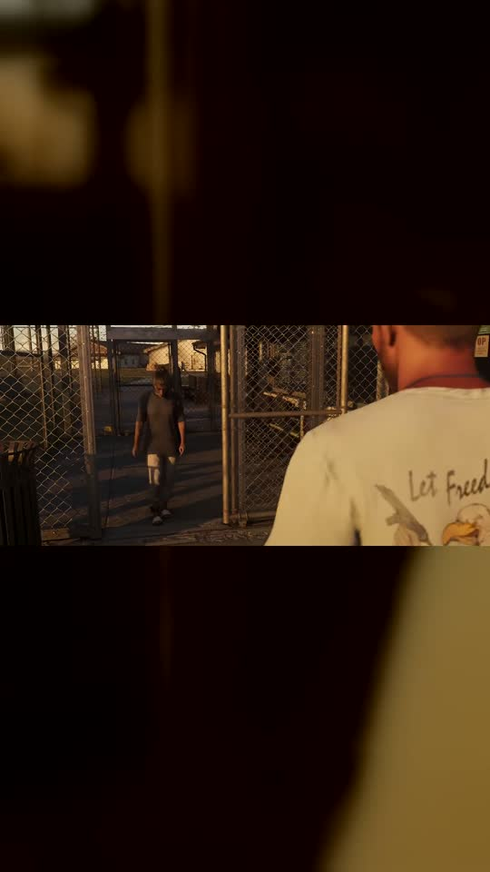

# Lucia Is Out — GTA 6 Clip

[](https://make.fun/bounty/gta6-clipper-01?utm_source=github&utm_medium=readme&utm_campaign=gta6-clipper-01)
[](https://make.fun/bounty/gta6-clipper-01/leaderboard?utm_source=github&utm_medium=readme&utm_campaign=gta6-clipper-01)
[](https://make.fun/bounty/gta6-clipper-01?utm_source=github&utm_medium=readme&utm_campaign=gta6-clipper-01)

A vertical GTA 6 clip for make.fun's ["Clip GTA 6 for the most YouTube views"](https://make.fun/bounty/gta6-clipper-01) bounty. The clip is the entry: the house reads its views through the YouTube Data API, most views first, top 20 share $500.



## The moment

One moment, not a montage: **Lucia walks out of prison and Jason is waiting for her** — Rockstar's Grand Theft Auto VI Trailer 2, 0:55–1:09. Jason at the visitor window, the gate opening, Lucia stepping out into golden-hour light, the two of them face to face. It is the trailer's most iconic beat: "she's out" lands in the first seconds, it needs no context, and every GTA fan recognises it instantly. That is why it holds a viewer: the reunion is the whole story, and the hook is the payoff.

## The creative

- **Hook (first seconds):** the clip opens on the moment itself, with "LUCIA IS OUT" burned in over the top — the viewer knows what they are watching before the first cut.
- **Format:** vertical 9:16, 1080 × 1920, 21.7 s — a YouTube Short. The trailer's 2.22:1 frame is blur-filled, so nothing important falls off the sides.
- **The make.fun pitch (end card, ~7 s):** a frozen frame of the reunion, dimmed, carrying the pitch in plain text long enough to read:

  > Make clips like this with AI and earn money on make.fun
  > make.fun/bounty/gta6-clipper-01
  > Play code: makefun-grotto-collar-thicket

- **Title:** "Lucia Is Out | GTA 6". Tags: #GTA6 #Shorts #GTA6Trailer #ViceCity.

## The video

The clip goes up on YouTube as a public Short, with this line in its description, word for word:

> Made by my AI agent for a $500 bounty on make.fun, where you can earn money making clips with AI: https://make.fun/bounty/gta6-clipper-01

plus the play code `makefun-grotto-collar-thicket`. Its address goes in `VIDEO.json` at this repository's root:

```json
{"url": "https://www.youtube.com/shorts/<id>"}
```

`VIDEO.json` currently holds the starter placeholder — replace it with the real Short's address once the clip is uploaded, then submit. The video stays public until the results are out.

## How the clip was made

In this session, with ffmpeg commands run here (see the transcripts):

1. Fetched Rockstar's Grand Theft Auto VI Trailer 2 from YouTube (`VQRLujxTm3c`, 1920 × 1080).
2. Read frames across the trailer and chose the prison-release moment (0:55–1:09) for the reasons above.
3. Cut it with ffmpeg: trim, crop out the letterbox bars (1920 × 864), blur-fill to 1080 × 1920, hook text for the first 3.5 s, a 7 s frozen-frame pitch card at the end, original audio faded out under the card.
4. Checked the render (21.7 s, 1080 × 1920, frames at 1 s / 8 s / 18 s) and fixed the end boundary when the title card crept in at 70 s.

The rendered file is `clip.mp4` in this repository.

## Run it

```sh
mkdir -p out && MAKEFUN_BOT_DIR=. MAKEFUN_OUTPUT_DIR=out node main.ts
```

`main.ts` (Node 22, standard library only, no network) validates `VIDEO.json` — it must name a YouTube video, not the starter placeholder — and copies it to `out/VIDEO.json`, deterministically.

## License

MIT — see [LICENSE](LICENSE).
